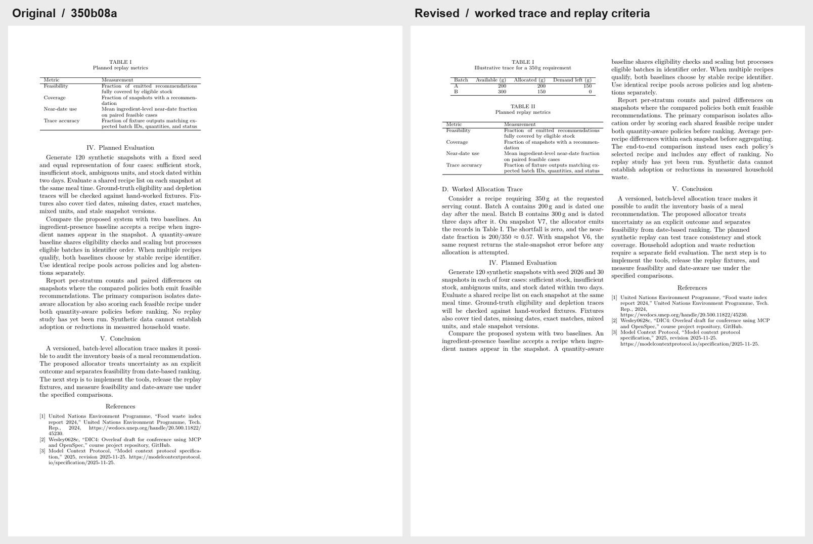

# 初稿與修訂版對照

初稿取自 [`350b08a`](https://github.com/timko1018/DIC4/tree/350b08ac803c7ded5f923ddcfb5a8e4756f65d36)。兩版皆以本機 XeTeX 編譯，下圖取自兩版 PDF 的第 2 頁。

| 改動 | 初稿 | 修訂版 |
| --- | --- | --- |
| 可追溯的食材分配 | 一句文字描述 350 g 需求 | 表 I 列出兩批原始量、分配量和剩餘需求。另計算近日期比例，並列出舊快照的錯誤結果。 |
| 評估設計 | 使用固定種子與配對比較 | 指定種子 2026、每組 30 筆，以及先在同一快照內平均再彙總的規則。 |
| 參考文獻 | 長網址出現字間距警告 | 參考文獻獨立成模組並靠左排版，重編譯後未出現該警告。 |

表 I 是手算示例。評估仍為計畫。
